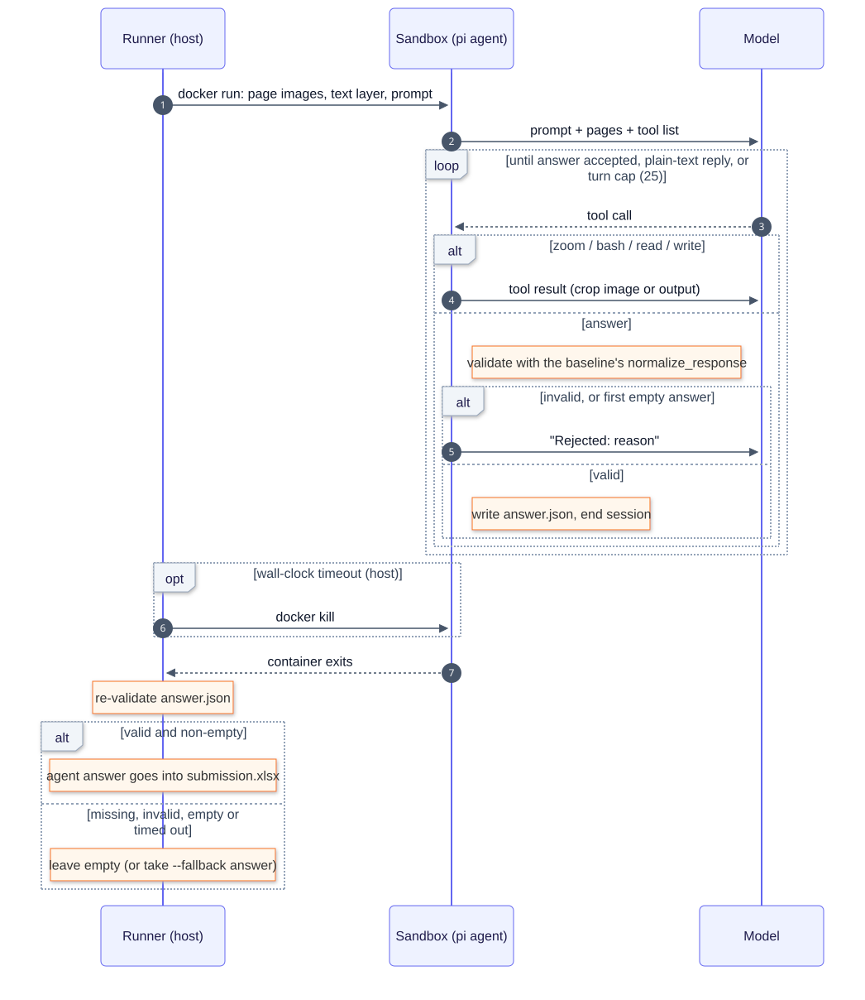

# Agentic harness: plan

How to run it: [agent-harness.md](agent-harness.md).

## 1. Idea

The baseline sends the page images and the question to Qwen and takes the answer, with one repair request when the format is wrong (71.6 points). The harness keeps the same model, inputs and answer contract, but lets the model work on the question like an engineer would: look at the page, zoom into the region it needs, search the PDF text layer, compute with Python, check the answer format, then submit.

One question = one isolated sandbox = one agent session = one answer. No multi-stage pipeline, no ensembles.

## 2. Why this should help

| Data fact | What the agent can do about it |
|---|---|
| 21 of 24 PDFs have a text layer (about a quarter of the questions) | Read exact strings and numbers with coordinates instead of reading pixels |
| 65 of 89 documents are photos/scans; small text in dense tables is the main failure source | `zoom` crops and enlarges the target region before reading it |
| 216 reasoning questions need sums, ratios, sorting | Python arithmetic instead of mental arithmetic; the baseline's `Decimal` recomputation still applies |
| Strict output formats (JSON arrays, structure JSON) | The `answer` tool rejects invalid answers with the reason, so the agent fixes them before submitting |

This covers two of the course's suggested directions ("定位目标表格，再裁剪并提高分辨率" and "OCR/版面 + 多模态大模型") with the model deciding where to look, instead of a fixed pipeline.

Compared with a separate OCR model such as PaddleOCR: for PDFs with a text layer the agent gets the same thing (text with coordinates), without recognition errors. For photos and scans nothing in the sandbox converts pixels to text; the model itself reads enlarged crops. OpenCV can find table grid lines to locate cells, which is a rough stand-in for layout analysis, not for text recognition.

## 3. Design

- **Sandbox:** one Docker container per question, on an internal network whose only reachable host is the model gateway. Read-only root, no capabilities, 1 CPU, 2 GB. Pre-installed: Python with pillow, pymupdf, numpy, pandas, opencv-python-headless, openpyxl. No OCR engines, no ML frameworks, no package installs at runtime.
- **Agent:** [pi](https://github.com/earendil-works/pi) (short system prompt, small tool set, chat completions with images). Tools: `read`, `bash`, `write`, plus two custom ones:
  - `zoom(page, x0, y0, x1, y1)` in 0-1000 coordinates, returns the enlarged crop as an image;
  - `answer(answer, calculations)` validates with the baseline's `normalize_response`, writes `answer.json`, ends the session.
- **Prompt:** the baseline's prompt for the question type (`tableqa/prompts.py`), plus a short note on the tools and on submitting through `answer`.
- **Limits:** 25 regular turns plus one answer-only turn, 30 minutes per question, maximum reasoning effort.
- **Model:** `qwen3.8-flash` on Alibaba Cloud Bailian for the real run. During development, the same harness ran against the open-weight Qwen3.8-Flash-Next model on a local vLLM server, which costs nothing per call.
- **Collection:** the host re-validates `answer.json` and writes `submission.xlsx`. A question without a valid answer stays empty.
- **Observability:** every model call goes through LiteLLM, which exports traces to Phoenix (tokens, latency, run/question tags); under heavy load some traces can be dropped. Full transcripts are kept per question.

## 4. Evaluation

The platform scores submissions (5 per day). The plan uses 1–2 submissions:

1. Run the agent on all 908 questions, submit, compare with the baseline's 71.6.
2. Report the cost next to the score: tokens, summed sandbox time, tool calls and turns per question (`report.json`).
3. Optional control: the one-shot baseline against the same model (one extra submission), so the score difference can be attributed to the harness rather than to a different model version.

No tuning against the leaderboard between submissions, so there is nothing to overfit.

Per-question analysis without the hidden answers: status counts, tool usage by question type and by PDF vs image, and transcripts of failures.

## 5. Expected outcome and risks

Guess, wide error bars: +2 to +6 points over one-shot, mostly on text-layer PDFs and reasoning questions. Structure questions (4% of the score) are unlikely to improve. A net loss is possible: small models in long tool loops make format mistakes and over-use tools.

Risks:

1. **Tool-calling reliability** of the model (malformed or quoted tool calls, loops). Mitigated by the turn cap, the `answer` validator and host re-validation.
2. **No `answer` call:** if the model ends with plain text, it is reminded once in the same session; if it stops again, the question stays empty.
3. **Images in tool results** must reach the model; run `agent.py smoke` once before the first run to check this.
4. **Cost:** an agent session uses many more tokens than one request. Recorded and reported, not hidden.
5. **Context growth:** every zoom adds an image, so the model API must accept about 30 images per request (`smoke` checks this).

## Sources

- Qwen3.8-Flash-Next model card: https://huggingface.co/Qwen/Qwen3.8-Flash-Next
- Bailian qwen3.8-flash: https://docs.modelstudio.console.alibabacloud.com/en/model-studio/qwen3-8-flash
- Bailian context cache: https://help.aliyun.com/zh/model-studio/context-cache
- Bailian OpenAI-compatible API: https://help.aliyun.com/zh/model-studio/qwen-api-via-openai-chat-completions
- pi: https://pi.dev/changelog/2026/5/7/pi-has-a-new-home
- pi custom models: https://unpkg.com/@earendil-works/pi-coding-agent@0.83.0/docs/models.md
- Phoenix tracing: https://arize.com/docs/phoenix/integrations/coding-agents/codex
- Crop/zoom agents for documents: https://arxiv.org/html/2604.09508, https://arxiv.org/pdf/2602.01334
- Sandbox isolation comparison: https://fly.io/learn/firecracker-vs-gvisor/
