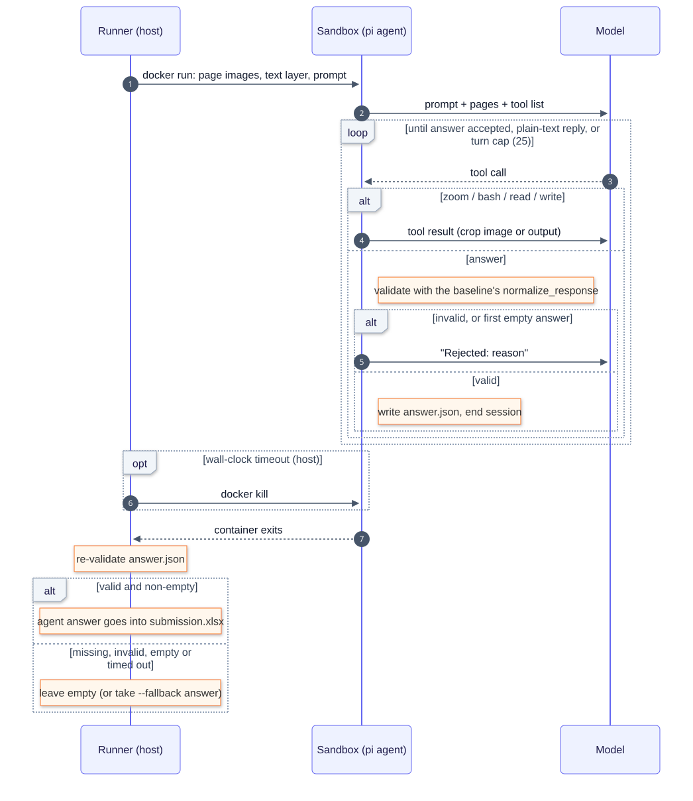

# Agentic harness: how to run

Design and rationale: [agent-harness-plan.md](agent-harness-plan.md).




Diagram sources are `docs/diagrams/*.mmd`. Re-render with bun (uses the installed Edge or Chrome; set `MERMAID_BROWSER` otherwise):

```bash
cd docs/diagrams && bun install && bun run render
```

Each question runs in its own Docker container with the [pi](https://github.com/earendil-works/pi) coding agent, the page images, the PDF text layer (when present), and a fixed offline Python toolset. The agent has two extra tools: `zoom` (crop and enlarge a page region) and `answer` (submit; validated with the baseline's `normalize_response`). All model calls go through a LiteLLM gateway that logs to Arize Phoenix.

## Layout

| Path | What |
|---|---|
| `agent.py` | CLI: `smoke`, `run` |
| `tableqa/agent.py` | Runner: materials, sandbox pool, validation, submission, cost report |
| `tableqa/smoke.py` | Endpoint checks |
| `agent/Dockerfile` | Sandbox image (pi 1.5.2, Python tools) |
| `agent/pi/` | pi config: `models.json`, `settings.json`, `agent-prompt.md`, `extensions/tableqa.ts` |
| `agent/tools.py` | `zoom` and answer `check` helpers used by the extension |
| `agent/compose.yaml`, `agent/litellm.yaml` | LiteLLM gateway + Phoenix |
| `tests/` | Unit tests and a scripted fake LLM for an offline end-to-end check |

## Setup (once)

Everything installs into `.venv/` or Docker images; nothing global.

```bash
uv sync
```

```bash
docker build -f agent/Dockerfile -t tableqa-agent:dev .
```

Set `.env` (git-ignored; see `.env.example`). `AGENT_BASE_URL` is read from inside the LiteLLM container: an endpoint on this machine's localhost is `http://host.docker.internal:<port>/v1`.

```bash
source .env && docker compose -f agent/compose.yaml up -d
```

Phoenix UI: http://127.0.0.1:6006. Gateway: http://127.0.0.1:4000/v1.

## Check the endpoint

```bash
source .env && uv run python agent.py smoke
```

It must pass: text, image input, tool call, image inside a tool result (pi's message format), 30 images in one request, thinking parsed into `reasoning_content`. The Responses API line is informational.

## Run

Pilot on 30 questions, then read a few transcripts:

```bash
source .env && uv run python agent.py run --name pilot --limit 30
```

All 908 questions:

```bash
source .env && uv run python agent.py run
```

Submit `runs/agent/submission.xlsx` on the platform and compare with the baseline's 71.6. Questions the agent could not answer stay empty, so the score is the agent's alone; `--fallback submission.xlsx` would fill them from the baseline instead.

Runs resume: finished questions (`records/<id>.json` with status `ok` or `empty`) are skipped. Delete a record to redo it.

Optional control: the one-shot baseline against the same endpoint, at the same thinking level, separates "different model build" from "agent harness" in the score difference.

```bash
source .env && uv run python baseline.py run --custom-endpoint --base-url http://127.0.0.1:4000/v1 --model "$AGENT_MODEL" --output-dir runs/baseline --workers 16 --thinking --max-tokens 65536
```

## Results

`runs/<name>/`:

- `submission.xlsx`: the file to submit.
- `report.json`: status counts, tool-call totals, mean turns, total tokens and sandbox time (the cost side of the result).
- `records/<id>.json`: answer, status, seconds, turns, tool counts, token usage.
- `work/<id>/session/*.jsonl`: full pi transcript (replayable), plus `stdout.txt`, `stderr.txt`, `answer.json`.

Statuses: `ok` (validated answer), `empty` (agent submitted an empty answer), `no_answer` (session ended without `answer`), `timeout`, `failed`.

## Observability

Phoenix gets one span per model call with latency, token counts, errors and the tag `run:<name>,q:<id>` (filter on `metadata.requester_metadata.headers.x-litellm-tags`). Message bodies are off (`turn_off_message_logging` in `agent/litellm.yaml`): with them on, each span carries every base64 image, about 3 MB per call. Full transcripts are the pi session files; `pi --export <file>` turns one into HTML.

## Offline check (no model needed)

`tests/fake_llm.py` is a scripted server: it calls `zoom`, then `answer`. It verifies the whole chain: sandbox, pi config, extension, image round-trip, LiteLLM, Phoenix, host validation.

```bash
AGENT_BASE_URL=http://fake-llm:8000/v1 docker compose -f agent/compose.yaml up -d
```

```bash
MSYS_NO_PATHCONV=1 docker run -d --name fake-llm --network tableqa-agent_default -v "$(pwd -W)/tests/fake_llm.py:/fake.py:ro" --entrypoint python3 tableqa-agent:dev /fake.py 8000
```

```bash
AGENT_MODEL=Qwen3.8-Flash-Next uv run python agent.py run --name e2e --ids 3,5,20 --max-turns 4
```

Expected: ids 3 and 20 `ok` with answer `42`; id 5 (`json_array`) `no_answer` after the validator rejects `42` and the turn cap aborts. Remove `runs/e2e` and `fake-llm` afterwards, then restart compose with the real `.env`.

## Knobs

`agent.py run` flags: `--name` (default `agent`), `--workers` (parallel sandboxes, default 16), `--timeout` (seconds per question, 1800), `--max-turns` (25), `--thinking off|high` (default `high`), `--limit`, `--ids`, `--fallback`.

Thinking defaults to the maximum: pi level `high` maps to `reasoning_effort: xhigh` in `chat_template_kwargs` (`agent/pi/models.json`). Sampling follows the model card: thinking temperature 1.0, top_p 0.95, top_k 20; with `--thinking off`, temperature 0.7, top_p 0.8. The card's presence penalty is left out because it works against copying repeated digits. The baseline's `--thinking` sends the same kwargs and sampling.

## Sandbox limits

Per container: internal network (only the gateway is reachable), read-only root filesystem, 512 MB tmpfs `/tmp`, writable `/work` only, 1 CPU, 2 GB RAM, 256 processes, all capabilities dropped, non-root user. Python packages: pillow, pymupdf, openpyxl, numpy, pandas, opencv-python-headless.
