# Agent harness: how to run it

The agent harness answers each competition question with an AI agent instead of a single model call. For every question, the harness starts a fresh Docker container. Inside it, the [pi](https://github.com/earendil-works/pi) coding agent looks at the page images, reads the PDF text layer when the document has one, crops and enlarges parts of the page, runs Python for arithmetic, and finally submits an answer. The model behind the agent is Alibaba Cloud Bailian's `qwen3.8-flash`.

The design and the reasons behind it are in [agent-harness-plan.md](agent-harness-plan.md).

The four diagrams below show the harness from four sides:

- **The parts and what each can reach.** The yellow dashed box is the course baseline, reused unchanged; everything else was added.
- **The states of one question** inside its sandbox. This is the core of the method.
- **The states of a whole run:** saved answers, the retry pass, the stop after repeated failures, and resuming after an interruption.
- **The messages of one ordinary question,** with one rejected answer.







## Quick start

You need three things installed: [Docker](https://docs.docker.com/get-docker/) (running, with Docker Compose 2.17 or newer), [uv](https://docs.astral.sh/uv/), and a Bailian API key from the [Alibaba Cloud Model Studio console](https://bailian.console.aliyun.com/).

1. Copy the settings template and fill in your API key and base URL:

   ```bash
   cp .env.example .env
   ```

2. Check that the model endpoint supports everything the harness needs. This sends about 15 small requests and costs well under ¥0.10:

   ```bash
   uv run agent.py smoke
   ```

3. Answer all 908 questions:

   ```bash
   uv run agent.py run
   ```

Each command reads `.env` by itself, rebuilds the sandbox image (this takes seconds when nothing changed), and starts the model gateway and the tracing service with Docker Compose. You do not need to run any setup commands first. The answers end up in `runs/agent/submission.xlsx`.

To try a few questions first, add `--limit 10` (the first ten questions) or `--ids 3,5,20` (specific questions). Use `--name` to keep separate runs in separate folders, for example `uv run agent.py run --name pilot --limit 30`.

When the first pass is done, the command goes once more over the questions that ended without an answer, because a model sometimes stops without calling `answer` and usually succeeds on a second try. If a run stops for any reason, start the same command again. Questions that already have an answer are skipped and cost nothing. This includes a question whose container saved its answer just before the run stopped. Questions that failed or ran out of time start again from the beginning, so the tokens they used before are paid again. To redo one question on purpose, delete its file in `runs/<name>/records/`.

Rerunning only some questions, for example with `--ids`, still writes every answer the run folder holds into `submission.xlsx`, not just the rerun ones. A run folder only accepts answers from one model on one server: it remembers both in `runs/<name>/origin.json` and refuses to continue if either changes, so a test run and the real run can never mix. Use a new `--name` for each server.

If 8 questions in a row fail, the run stops starting new questions, because that usually means the API key, the quota or the service is broken. The questions that were never started get the status `not_started`. The command then exits with an error and tells you to run it again once the problem is fixed.

## Where the model runs

The main and production target is Alibaba Cloud Bailian. The competition requires Qwen models served by Alibaba Cloud, and the final submission must come from a Bailian run.

For development, the harness also works with a model server on your own machine, such as [vLLM](https://docs.vllm.ai/), [SGLang](https://docs.sglang.ai/) or [Ollama](https://ollama.com/), as long as it speaks the OpenAI chat-completions API. Testing against a local server costs nothing, so it is the right place to try prompt or tool changes before spending money on the real endpoint. The `runs/full` results below came from such a development run. To use a local server:

- Put the local settings in their own file, for example `.env.local`, so the real Bailian key never goes to the test server. Pass it with `uv run agent.py --env-file .env.local run --name local`.
- Set `DASHSCOPE_BASE_URL` to the server's address as seen from inside Docker, for example `http://host.docker.internal:8000/v1`. Docker containers cannot reach `127.0.0.1` on your machine, which is why the address uses `host.docker.internal`.
- Set `DASHSCOPE_MODEL` to the name the server uses for the model, for example `Qwen3.8-Flash-Next`. The agent still asks the gateway for `qwen3.8-flash`, and the gateway passes the request on under the server's name.
- Set `DASHSCOPE_API_KEY` to any non-empty text if the server does not check keys.
- With many parallel containers, also set `PHOENIX_HIDE_MESSAGES='true'`, so Phoenix records only timing and token counts (see "Watching a run").

The settings for the development run in this repository looked like this:

```bash
export DASHSCOPE_BASE_URL='http://host.docker.internal:8000/v1'
export DASHSCOPE_API_KEY='local-test'
export DASHSCOPE_MODEL='Qwen3.8-Flash-Next'
export AGENT_MODEL='qwen3.8-flash'
export PHOENIX_HIDE_MESSAGES='true'
```

Bailian reads the thinking settings as top-level request fields. A local server usually reads them from `chat_template_kwargs` instead and ignores the top-level fields, so on a local server the model uses its chat template's default thinking behaviour.

## What one question looks like

1. The host prepares the document once and keeps the result in `runs/cache/`: page images (the same renderer as the baseline) and, for PDFs, the text layer with word coordinates. Some PDFs have a broken text layer, where the fonts map every character to the wrong symbol, so the text reads like `!"#$%&'()*+`. The host leaves such a layer out (fewer than half of its characters are letters, digits or Chinese characters), and the agent reads the page image instead.
2. The host starts a container for the question. The container has no internet access. The only address it can reach is the LiteLLM model gateway.
3. The agent receives the page images and the question, and works for up to 25 turns. Besides `read`, `bash` and `write`, it has two tools written for this task:
   - `zoom` crops a region of a page and returns it enlarged.
   - `answer` checks the answer against the required format (with the baseline's own validator) and ends the session. If the answer has the wrong format, the tool rejects it and tells the agent why, so it can fix it.
4. If the agent reaches the 25-turn limit, it gets one last turn in which it can only call `answer`.
   If the agent instead stops early without calling `answer` (a model sometimes leaves the answer in its thinking), the harness reminds it once, in the same session, to call `answer`. The work done so far is kept.
5. The host validates the answer again, because it never trusts what comes out of a container, and writes it into `submission.xlsx`. If the agent passed its whole output object as the answer text, for example `{"answer": "培养计划课程"}`, the validator takes the inner value.

The prompt never contains a file name or a question number. Any file name in the question text, including short forms such as `62.pdf` for the file `062.pdf`, is replaced with "该文档" ("this document"). The question number is only in an environment variable inside the container, where pi uses it to tag the traces in Phoenix.

## Model settings

These are set in `agent/pi/models.json` and sent with every model call:

| Setting | Value | Why |
|---|---|---|
| `enable_thinking` | `true` | The model reasons before it answers or calls a tool. |
| `reasoning_effort` | `xhigh` | The highest level Bailian offers for qwen3.8-flash (`max` and `high` mean the same). |
| `preserve_thinking` | `true` | The model's earlier reasoning stays in the conversation, so later turns build on it. Bailian bills it as input. |
| `vl_high_resolution_images` | `true` | Without it, Bailian shrinks every image larger than about 2.6 megapixels. About one page image in five is larger than that, and small table text becomes harder to read when it shrinks. |
| `temperature`, `top_p`, `top_k` | 0.6, 0.95, 20 | Bailian's documented settings for qwen3.8-flash in thinking mode with image input ("0.6 for visual understanding, 1.0 for text input"). Every question starts from page images. The local development runs up to `runs/local-v2` used 1.0. |

`uv run agent.py run --thinking off` turns thinking off (temperature 0.7, top_p 0.8).

## Cost and prompt caching

Bailian charges ¥0.8 per million input tokens and ¥2.7 per million output tokens for qwen3.8-flash in the Beijing region (price list read on 2026-11-19). Reasoning tokens count as output.

Every turn of an agent session sends the whole conversation again, so most of the input is a repeat of the previous call. Bailian's implicit context cache recognises a repeated beginning of a request (at least 1,024 tokens) and charges cached tokens at a fraction of the input price. The cache works automatically and needs no request changes. The harness only has to keep earlier messages byte-for-byte identical, which pi does: it appends new messages and never edits old ones. Questions about the same document also share the system prompt, the tool list and the page images at the start of the first request, so they can hit the cache too.

Bailian also offers an explicit cache with `cache_control` markers. The harness does not use it: creating an explicit cache entry costs more than normal input, and a hit is billed the same as an implicit hit.

`runs/<name>/report.json` prints three cost figures:

- `no_cache`: the price if nothing had been cached.
- `reported_cache_hits`: the price with the cache hits that Bailian reported. This is the closest figure to the real bill.
- `prefix_cache_best_case`: the price if every repeated beginning had been cached.

## Watching a run

Open Phoenix at http://127.0.0.1:6006 and choose the project. The project is `tableqa-agent` unless the env file sets another name with `PHOENIX_PROJECT`, for example `export PHOENIX_PROJECT='tableqa-bailian'`, which keeps the Bailian run apart from local test runs. Every model call appears there while the run is going, with the full messages, token counts, latency and errors. Each call is tagged `run:<name>,q:<question id>`.

Each call carries base64 page images of 1 to 2 MB. In an earlier run with 32 parallel containers, Phoenix fell behind and LiteLLM dropped some traces. If that happens, the run itself is not affected, because the complete record of every session is saved on disk in `runs/<name>/work/<id>/session/`.

For runs with many parallel containers, set `PHOENIX_HIDE_MESSAGES='true'` in the env file. Phoenix then records each call's timing, token counts and errors, but shows the messages as `redacted-by-litellm`. Without the setting, the gateway logs the full messages.

If you do not need tracing, you can ignore Phoenix. It runs as its own container and the harness works the same without anyone looking at it.

## Output files

Everything for a run is in `runs/<name>/`:

- `submission.xlsx` is the file to upload to the competition platform.
- `report.json` contains status counts, tool-call totals, average turns, token totals, the cost figures and the total container time.
- `records/<id>.json` holds one question's answer, status, time, turns, tool counts and token usage.
- `work/<id>/session/*.jsonl` is the full agent transcript. `stdout.txt`, `stderr.txt` and `answer.json` are next to it.

A question ends with one of these statuses: `ok` (a validated answer), `empty` (the agent decided the answer is empty), `no_answer` (the session ended without calling `answer`), `timeout`, `failed`, or `not_started` (skipped after 8 failures in a row). Questions without an answer stay empty in the submission. With `--fallback submission.xlsx`, they are filled from another submission, such as the baseline's.

## Results

### Development run on a local server (2026-11-17)

This run used the open-weight Qwen3.8-Flash-Next model on a local vLLM server, with the same thinking level as above.

| | Baseline (one model call per question) | Agent harness |
|---|---|---|
| Platform score | 71.6 (about 650 of 908 correct) | **78.7** (about 715 of 908 correct) |
| Answers submitted | 908 | 907 (the agent left 1 empty on purpose) |

- No answers were taken from the baseline.
- The agent used 19.95 million input tokens and 0.99 million output tokens, with 3.14 turns per question on average.
- Tool calls: 1,523 `zoom`, 725 `bash`, 134 `read` and 917 `answer`.
- At Bailian prices, those tokens would cost ¥18.65 with no caching, or ¥8.05 if every repeated prefix were cached. That is ¥0.01 to ¥0.02 per question.
- The 30 questions about the three PDFs with broken text layers (071, 072 and 073) used 26% of all tokens: 9.4 turns and about 185,000 tokens per question, against 2.8 turns and 22,000 tokens for the other PDFs. The agent kept trying to read the garbled text. The harness now leaves such text layers out.
- Without ground truth, a comparison with the baseline's answers showed two weak spots. On table-structure questions, the agent tends to return more cells than the requested part of the table. About 30 text answers are full sentences instead of bare values.

### Test run on Bailian (2026-11-19)

Before the full run, `uv run agent.py smoke` passed all its checks on Bailian, and 10 questions (3 structure, 4 extraction, 3 reasoning) ran through the whole harness with 10 containers in parallel:

- All 10 questions ended `ok`.
- 6 answers were identical to the local development run. Checked by hand against the documents, the other 4 were no worse: in two (q448, a phone number, and q699, a four-row table header) the Bailian answer was right and the local one wrong. The other two (q589 and q749) differ only in whether an empty top-left header corner counts as one merged cell or two cells, which the page does not settle.
- Bailian reported 88% of all input tokens as cache hits (578,816 cached, 79,049 not cached). The 10 questions cost ¥0.18, compared with ¥0.59 if nothing had been cached.
- Most questions took 8 to 73 seconds. The slowest one, a large table-structure question, used 23 turns and took 9.6 minutes. On the local server, the same questions took 31 to 441 seconds each.

At this rate, all 908 questions should cost roughly ¥10 to ¥20 and take about 1.5 hours with 16 containers.

## Command options

`uv run agent.py run` accepts:

| Option | Default | Meaning |
|---|---|---|
| `--name` | `agent` | Run name and output folder under `runs/` |
| `--workers` | 16 | Number of containers running at the same time |
| `--timeout` | 1800 | Seconds allowed per question |
| `--max-turns` | 25 | Turns before the final answer-only turn |
| `--thinking` | `high` | `high` sends `reasoning_effort: xhigh`; `off` disables thinking |
| `--limit`, `--ids` | all | Run only the first N questions, or only the listed ids |
| `--fallback` | none | Fill unanswered questions from another submission file |
| `--no-setup` | off | Skip building the image and starting the gateway |
| `--retries` | 1 | Extra passes over questions that ended without an answer (a model sometimes stops without calling `answer`) |
| `--resume` | off | Only for sessions saved before the final answer-only turn existed: give them that one turn and start nothing new |

`--env-file` and `--no-setup` belong before the command name, for example `uv run agent.py --env-file test.env smoke`. Variables that are already set in your shell take priority over the file.

With 16 workers, the run makes a few calls per second and uses well under Bailian's rate limit for the Beijing region (5 million tokens per minute at the lowest spending level). Each container is limited to 1 CPU and 2 GB of memory, but uses far less in practice, so 16 containers fit on an ordinary desktop computer.

## Offline check without a model

`tests/fake_llm.py` is a scripted model server. It always calls `zoom` first and then `answer`, and it prints every request it receives. It tests the whole chain without spending money: the container, the pi settings, the tools, images inside tool results, the gateway, Phoenix and the host-side validation.

```bash
docker build -f agent/Dockerfile -t tableqa-agent:dev .
```

```bash
export DASHSCOPE_BASE_URL=http://fake-llm:8000/v1 DASHSCOPE_API_KEY=fake AGENT_MODEL=qwen3.8-flash
```

```bash
docker compose -f agent/compose.yaml up -d
```

```bash
MSYS_NO_PATHCONV=1 docker run -d --name fake-llm --network tableqa-agent_default -v "$(pwd -W)/tests/fake_llm.py:/fake.py:ro" --entrypoint python3 tableqa-agent:dev /fake.py 8000
```

```bash
uv run agent.py run --name e2e --ids 3,5,20 --max-turns 4
```

On Linux and macOS, replace `$(pwd -W)` with `$(pwd)` and drop `MSYS_NO_PATHCONV=1`.

Expected result: questions 3 and 20 end `ok` with the answer `42`. Question 5 needs a JSON array, so the validator rejects `42` and the question ends `no_answer`. `docker logs fake-llm` shows the exact fields the gateway forwarded, including `enable_thinking`, `reasoning_effort`, `preserve_thinking` and the replayed `reasoning_content`. Afterwards, delete `runs/e2e`, run `docker rm -f fake-llm`, open a new terminal (so the three exported variables are gone), and run the smoke test again so that the gateway switches back to the settings in `.env`.

## Sandbox limits

Each container runs on an internal Docker network where the only reachable address is the gateway. It has a read-only root filesystem, a 512 MB `/tmp`, a writable `/work` folder, 1 CPU, 2 GB of memory and at most 256 processes. All Linux capabilities are dropped and it runs as a normal user. The Python packages inside are pillow, pymupdf, openpyxl, numpy, pandas and opencv-python-headless. There are no OCR engines and no machine-learning frameworks, and nothing can be installed at run time.

Two things are limited only by the per-question timeout:

- `/work` is a folder on the host without a size quota, so a runaway script could fill the host disk. Keep an eye on free disk space during a full run.
- Code that the agent runs with `bash` could call the gateway directly, outside the turn limit. The gateway only forwards `qwen3.8-flash`, so such calls cannot reach a more expensive model. To spot them, compare the token totals in `report.json` with the totals in Phoenix.

The Bailian API key is only given to the gateway container. The agent containers never see it.

## Project layout

| Path | What it contains |
|---|---|
| `agent.py` | The command-line entry point (`smoke` and `run`) |
| `tableqa/agent.py` | The runner: document preparation, the container pool, validation, the submission file and the cost report |
| `tableqa/smoke.py` | The endpoint checks behind `agent.py smoke` |
| `agent/Dockerfile` | The sandbox image: pi 1.5.2 and the Python tools |
| `agent/pi/` | pi settings: the model settings, the extra system prompt, the turn limit and the `zoom` and `answer` tools |
| `agent/tools.py` | The Python helpers behind `zoom` and the answer check |
| `agent/compose.yaml`, `agent/litellm.yaml` | The LiteLLM gateway and Phoenix |
| `tests/` | Unit tests, a check that settings repeated across files agree (`test_config.py`), and the fake model server |

Run the unit tests with `uv run pytest`. The diagrams are generated from `docs/diagrams/*.mmd`. To redraw them, run `bun install` and then `bun run render` in `docs/diagrams`; add a name such as `bun run render architecture` to redraw only that one. This uses the installed Edge or Chrome browser (set `MERMAID_BROWSER` to use another one). The font, Source Sans 3, comes from npm and is embedded in each SVG file, so the diagrams look the same on machines without the font. The course report is built the same way: `bun install` and `bun run build` in `docs/report` turn `report.md` into `report.pdf`.
