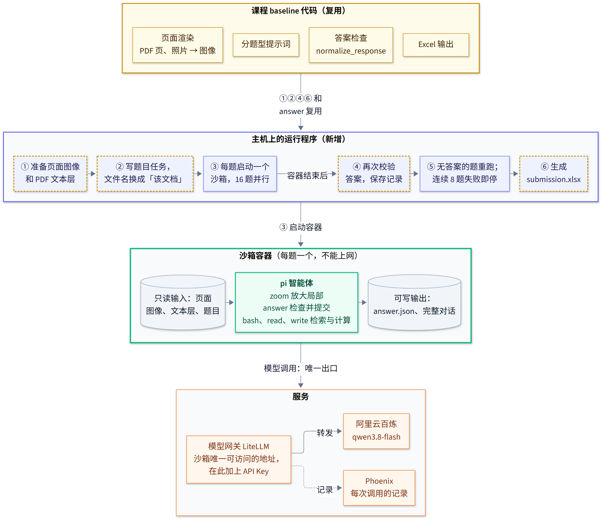
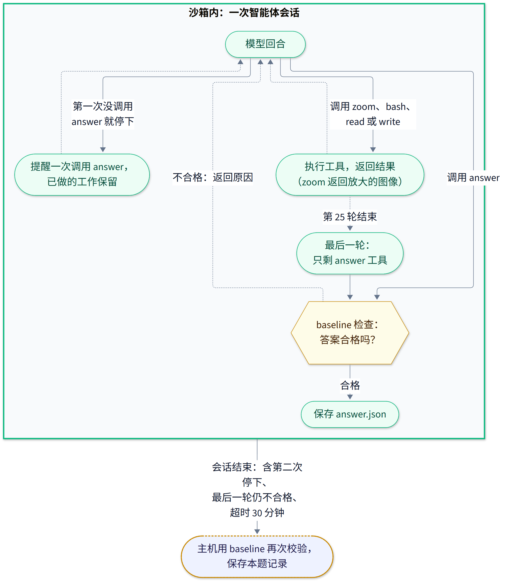

# 复杂表格识别与内容理解：在隔离沙箱中解题的表格问答智能体

**团队成员**：郑皓名（23340240063）、黄泓力（24340240003）　**平台用户名**：Nick_lessonUSE

**代码**：https://github.com/eric15342335/AIFep-FDU.github.io （`uv run agent.py run` 一条命令复现）

## 1 方法

Baseline 将整页图像和题目一并发给 qwen3.8-flash 并直接取回答案；若答案格式不对或为空，则追加一次修复请求，部分题型还会改换输出格式重试，平台得分为 71.6。我们使用同一个模型，复用 baseline 的页面渲染、题型提示词和答案格式，同时提供 PDF 文本层并让模型分步解题：先看整页，再放大所需区域；文档有 PDF 文本层时直接检索原文；计算交给 Python 完成；最后提交答案并当场接受格式检查。

每道题都在独立的 Docker 容器（沙箱）中运行一个 [pi](https://github.com/earendil-works/pi) 智能体。该沙箱无法访问外网，所在内部网络中只有模型网关一个服务。同时，页面图像、文本层和题目以只读方式放入沙箱，答案和完整对话则写入可写的输出目录。智能体配备了五个工具：

- `zoom`：按 0 到 1000 的相对坐标裁剪页面中的一块区域，放大后作为图像返回，以便看清小字和密集表格；
- `answer`：调用 baseline 的检查函数 `normalize_response` 校验答案，若不合格则返回原因，合格则保存答案并结束会话；
- `bash`、`read`、`write`：用于检索文本层和运行 Python 计算。

PDF 文本层是 PDF 中随页面一起保存的文字和坐标，比直接从图像中辨认更准确。89 份文档中有 21 份 PDF 带有文本层，但其中 3 份字体编码错误，文字全是乱码，模型读到后会反复尝试，白白消耗 token。为此，程序会逐页检查字母、数字和汉字占非空白字符的比例，低于一半就跳过该页的文本层，让模型改看图像。此外，题目里出现的文件名一律替换为"该文档"，以免模型从文件名猜答案。

<figure class="wide"><figcaption>图 1　系统结构。黄底大框：课程 baseline 代码；黄色虚线边框的步骤：调用这些代码；其余为新增部分。</figcaption></figure>

## 2 创新点

<figure class="side"><figcaption>图 2　单道题的状态机。绿色：会话内的步骤；黄色：baseline 答案检查；虚线：回到下一回合。</figcaption></figure>

1. **文字与图像对齐，由模型决定看哪里。** 文本层中每个词的位置都换算到 `zoom` 所用的同一套 0 到 1000 坐标，因此模型可以先在文本里搜到目标数字或表头，再直接放大该位置核对图像。这一设计把课程建议的两条路线（"定位表格、裁剪并提高分辨率"和"文字识别结果加多模态模型"）结合起来，并由模型按题决定步骤：简单的题查看整页即可提交，复杂的题则反复检索、放大并用 Python 核算。
2. **格式检查成为模型可调用的工具。** Baseline 是在答案返回后才检查格式，而我们将同一个检查函数做成 `answer` 工具：模型看到拒绝原因后，可以继续放大、检索或计算，再提交改正后的答案；容器运行结束后，主机还会再用同一个函数复核一次。
3. **出错时保留已做的工作（图 2）。** 单题求解时，答案被拒后可以修改；会话首次结束仍没有被接受的答案时，会在同一会话内提醒一次；用满 25 轮后再给一轮只能提交答案的机会；若 30 分钟仍未结束则强制停止。整批运行时，没有答案的题会自动重跑一遍；若连续 8 题失败则不再开启新题；运行中断后重新执行同一命令时，已保存的合格答案会直接复用，不会重复计费。
4. **工程保障。** API Key 仅保存在网关容器中，沙箱无法获取；网关会将模型调用上报到 Phoenix（用时和 token 数，消息内容可选），同时每道题均另存完整对话。此外，为了让百炼的隐式上下文缓存生效，对话只在末尾追加而从不改写前文：我们关闭了上下文压缩，并开启 `preserve_thinking` 保留之前的推理。

## 3 实验设置

模型采用百炼北京地域的 qwen3.8-flash，开启思考模式并将推理强度设为最高档 xhigh，同时开启 preserve_thinking 和高分辨率图像输入（96 页图像中有 37 页超过默认的 2.6 MP 上限，不开启则会被缩小）。采样参数采用百炼对图像输入思考模式给出的默认值：temperature 0.6、top_p 0.95、top_k 20；而 baseline 使用 temperature 0 并关闭思考。运行时，每题最多包含 25 轮常规回合加 1 轮只能提交答案的回合，限时 30 分钟，并以 16 道题并行执行。模型推理全部在百炼完成，而沙箱容器、模型网关和 Phoenix 则运行在我们自己的电脑上，负责裁剪图像、运行 Python、转发请求和记录日志。

## 4 结果

| 方案 | 模型来源 | 平台得分 |
|---|---|---|
| Baseline（整页直接作答） | 百炼 qwen3.8-flash | 71.6 |
| **本方案（正式提交）** | **百炼 qwen3.8-flash** | **78.6（+7.0）** |

在正式运行中，908 道题全部得到了通过格式校验的非空答案，且未触发重跑。平均每题进行 3.5 轮（中位数为 2 轮），调用 zoom 2.0 次、bash 0.95 次；16 道题并行运行，共用时约 28 分钟。下表按百炼北京地域的价格和百炼报告的缓存命中情况估算费用（缓存命中的单价按美元价格比例折算）。输入 token 中有 80.6% 命中了缓存，因此总费用只有 8.61 元，约合每题 0.95 分钱；若没有缓存，则需 21.62 元。

| | 输入（未命中缓存） | 输入（命中缓存） | 输出（含思考过程） | 合计 |
|---|---|---|---|---|
| Token（百万） | 4.47 | 18.59 | 1.18 | 24.23 |
| 费用（元） | 3.57 | 1.86 | 3.18 | **8.61** |
